# 🪔 등잔 (Lamp)

> **기여의 증거는 늘 우리 곁에 있었다. 기록되지 않았을 뿐.**

팀 프로젝트를 하는 공간을 그대로 제공하고, 그 안에서 일어나는 활동(문서 작성, 할 일, 회의 출석, 파일 버전)을 **자동으로 기여 증거로 남기는** 팀플 협업 플랫폼입니다.
학생은 "내가 한 일"을 따로 증명할 필요가 없고, 교수는 팀원별 기여와 그 근거를 한 화면에서 확인할 수 있습니다.

**▶ 라이브 데모: https://infosys-hackathon-two.vercel.app**
로그인 화면의 **「학생으로 체험」**, **「교수로 체험」** 버튼을 누르면 별도 가입 없이 예시 데이터로 바로 둘러볼 수 있습니다.

<p align="center">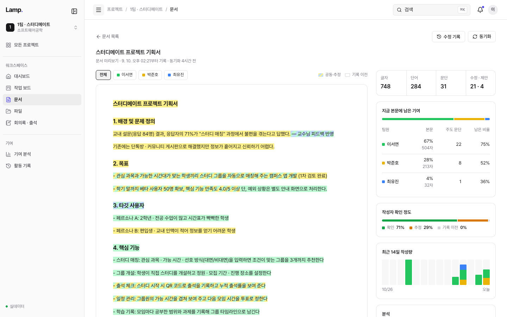</p>

---

## 목차

- [왜 만들었나](#왜-만들었나)
- [핵심 기능](#핵심-기능)
- [화면 둘러보기](#화면-둘러보기)
- [기여를 어떻게 기록하나](#기여를-어떻게-기록하나)
- [아키텍처와 기술 스택](#아키텍처와-기술-스택)
- [직접 실행하기](#직접-실행하기)
- [프로젝트 구조](#프로젝트-구조)
- [문서와 발표 자료](#문서와-발표-자료)

## 왜 만들었나

대학 팀플에서 기여도 평가는 대부분 학기 말 **동료 평가** 한 장에 의존합니다.

- 열심히 한 학생은 자기 몫을 증명할 방법이 없고, 무임승차는 평가지 한 장으로 가려집니다.
- 교수는 팀 내부에서 무슨 일이 있었는지 볼 수 없어 결과물만으로 판단합니다.
- 활동 기록은 메신저, 구글 문서, 노션 등에 흩어져 있어 나중에 모으기 어렵습니다.

등잔은 **팀플을 하는 곳 자체**가 되어, 따로 기록하지 않아도 작업 과정이 근거로 남게 합니다.

## 핵심 기능

| 기능 | 설명 |
| --- | --- |
| **구글 문서 작성자 추적** | 팀이 쓰는 Google Docs · Slides · Sheets를 연결하면 수정 이력을 동기화해, 누가 어떤 문장을 썼는지 본문 위에 팀원별 색으로 표시합니다. |
| **활동 기록 타임라인** | 문서 변경 전후 내용, 할 일 상태 변경, 회의 출석, 파일 업로드가 시간순으로 쌓입니다. 원본 기록은 수정하거나 삭제할 수 없습니다. |
| **작업 보드 · 회의록 · 파일** | 칸반 보드, 회의 출석 체크와 회의록, 버전이 남는 파일 보관함을 한 워크스페이스에서 씁니다. |
| **AI 기여 분석** | 쌓인 기록을 근거로 팀의 흐름, 팀원별 기여, 살펴볼 점과 제안을 문장으로 정리합니다. 모든 문장은 실제 기록 ID를 근거로 달고, 근거가 맞지 않으면 규칙 분석 결과로 되돌립니다. |
| **교수 대시보드** | 담당 수업의 팀별 지표, "변경 없는 팀원" 같은 신호, 팀원별 분석과 기록을 읽기 전용으로 봅니다. 교수용 분석에는 면담에 쓸 지도 포인트가 들어갑니다. |
| **한양대 계정 로그인** | `@hanyang.ac.kr` 구글 계정으로만 가입하고 로그인합니다. 심사용 데모 계정은 버튼 한 번으로 들어갈 수 있습니다. |

## 화면 둘러보기

### 학생

| | |
| --- | --- |
| 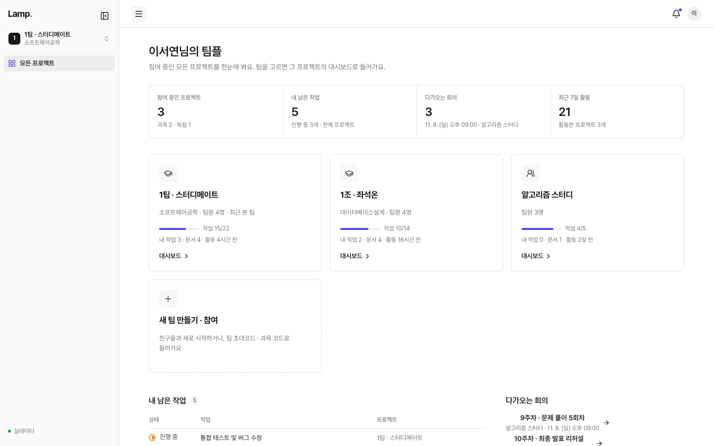<br>**내 팀플 홈**: 참여 중인 프로젝트, 남은 작업, 다가오는 회의를 한눈에 봅니다. | 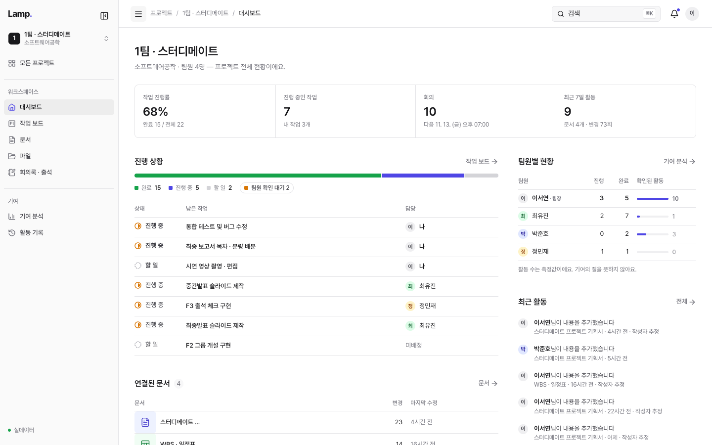<br>**팀 대시보드**: 진행률, 남은 작업과 담당자, 팀원별 현황, 최근 활동. |
| 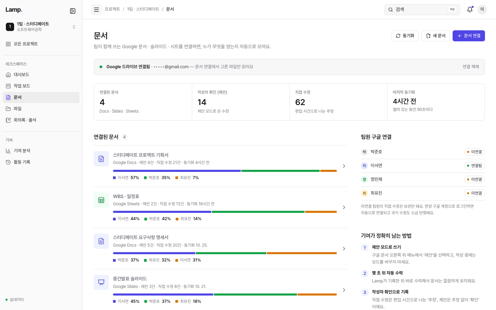<br>**연결된 문서**: 문서마다 팀원별 작성 비중을 막대로 보여 줍니다. | <br>**문서 작성자 표시**: 본문을 팀원별 색으로 칠하고, 지금 본문에 남아 있는 기여 비율을 계산합니다. |
| 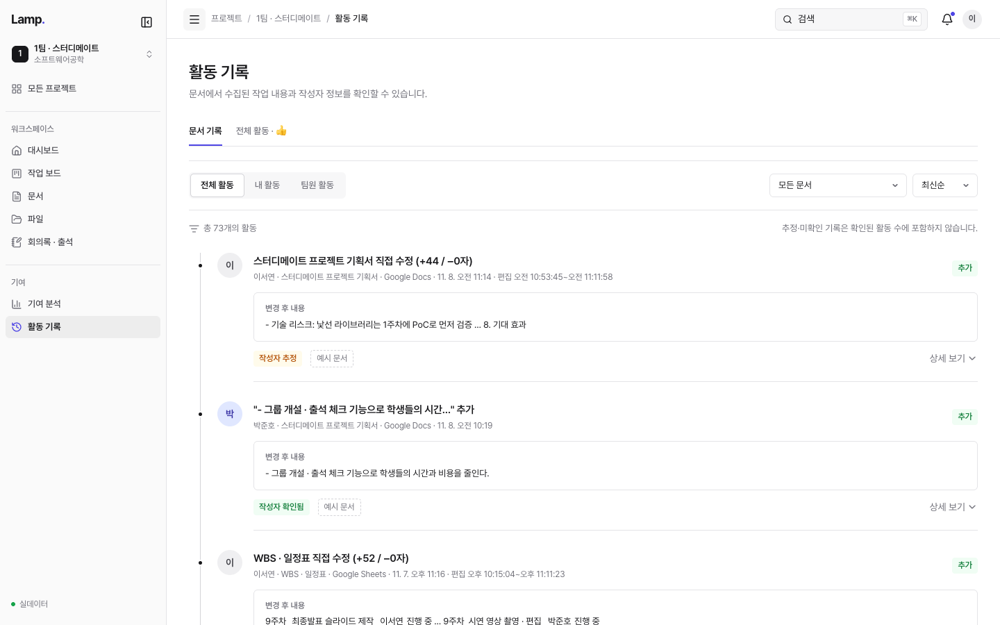<br>**활동 기록**: 변경 전후 내용과 작성자 확인 상태가 함께 남습니다. | 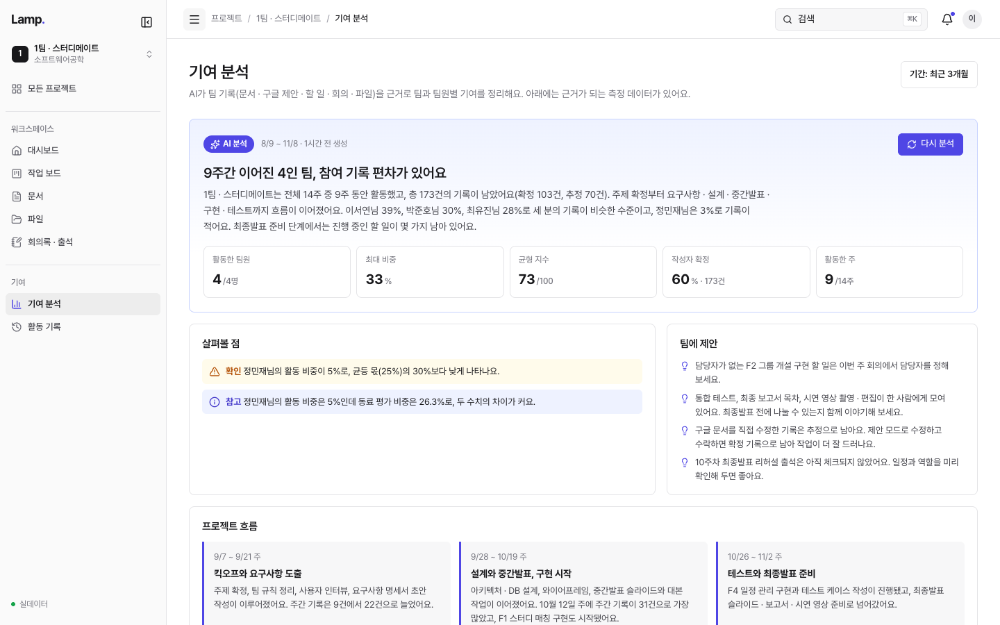<br>**AI 기여 분석**: 팀의 흐름과 균형 지수, 살펴볼 점, 팀에 대한 제안. |
| 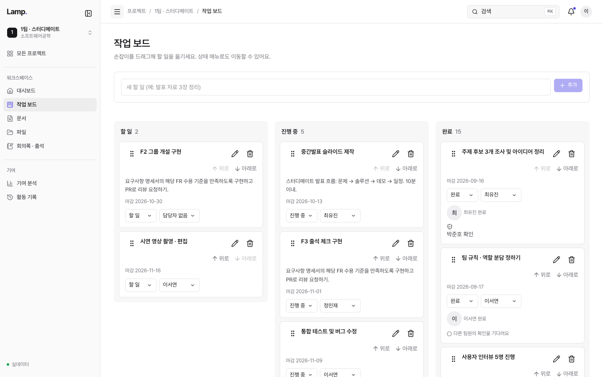<br>**작업 보드**: 할 일 · 진행 중 · 팀원 확인 대기 · 완료. | 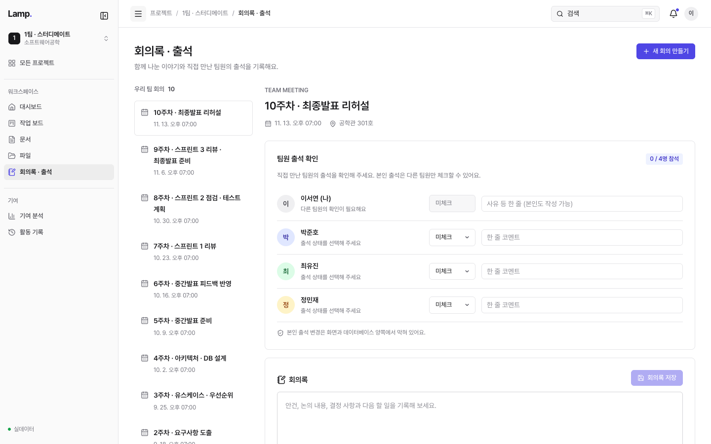<br>**회의록 · 출석**: 직접 만난 팀원의 출석을 서로 확인합니다. |

### 교수

| | |
| --- | --- |
| 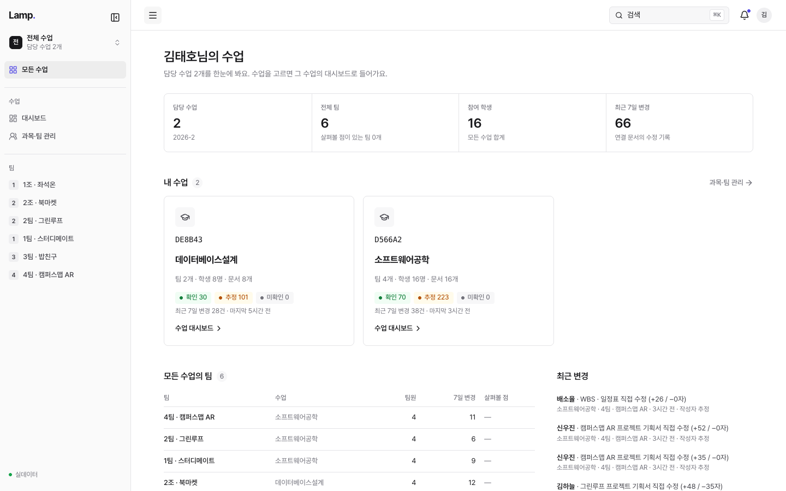<br>**담당 수업 홈**: 수업별 팀 수, 학생 수, 확인 · 추정 · 미확인 기록 수. | 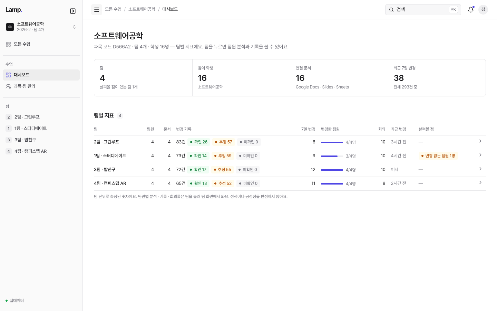<br>**수업 대시보드**: 팀별 지표와 "변경 없는 팀원" 같은 살펴볼 신호. |
| 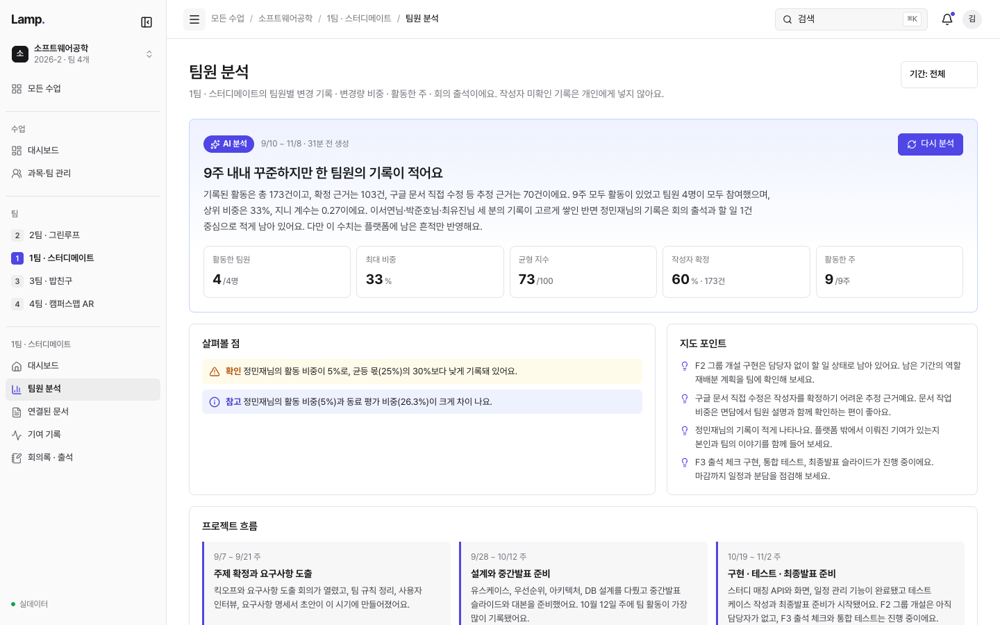<br>**팀원 분석**: 교수용 AI 분석과 면담에 쓸 지도 포인트. | 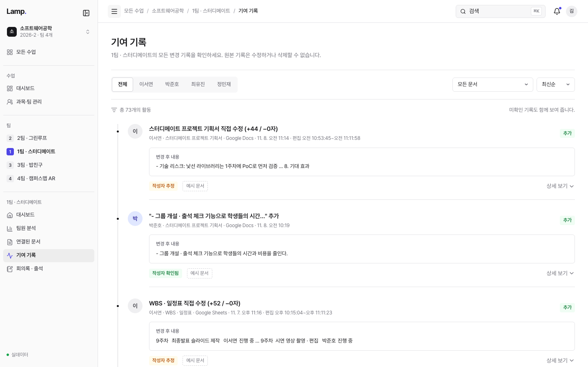<br>**기여 기록**: 팀원별로 걸러 볼 수 있는 읽기 전용 원본 기록. |

> 스크린샷은 라이브 데모의 예시 데이터로 찍었고, 개인 이메일 주소는 가렸습니다.

## 기여를 어떻게 기록하나

모든 기록에는 **작성자를 얼마나 확실히 아는지**가 함께 붙습니다. 확실하지 않은 기록을 확실한 것처럼 보여 주지 않는 것이 원칙입니다.

| 상태 | 의미 | 예시 |
| --- | --- | --- |
| **확인** | 작성자가 분명한 기록 | 등잔 안에서 한 작업, 구글 문서의 **제안 모드** 수정, 팀원이 서로 확인한 출석 |
| **추정** | 정황으로 작성자를 추정한 기록 | 구글 문서의 직접 수정 (편집 시간대로 나눔) |
| **미확인** | 작성자를 알 수 없는 기록 | 구글 계정을 연결하지 않은 팀원의 수정. 개인 기여에는 넣지 않습니다. |

- **제안 모드 자동 수락:** 구글 문서에서 제안 모드로 쓰면 등잔이 작성자를 기록한 뒤 몇 초 안에 자동으로 수락합니다. 문서는 깔끔하게 유지되고 기록은 "확인"으로 남습니다.
- **기여 증거는 서버에서만 계산:** 글자 수나 변경량은 클라이언트가 보내지 않습니다. 서버 API가 계산해 Postgres 함수(RPC)로 저장하고, RLS로 팀원과 담당 교수만 읽을 수 있게 합니다.
- **AI는 판정하지 않음:** AI 분석은 성적이나 공정성을 판정하지 않습니다. 규칙 엔진이 계산한 수치와 기록 ID를 근거로 설명을 붙일 뿐입니다. 결과는 저장해 두고, **다시 분석**을 누를 때만 새로 만듭니다.

## 아키텍처와 기술 스택

```
 브라우저 (학생 · 교수)
      │
      ▼
 Next.js 16 on Vercel ── App Router · Cache Components · proxy.ts(세션 갱신)
      │   ├─ Route Handlers: /api/google/*  /api/ai-report  /api/documents  /api/files
      │   └─ 서버 전용 키(service_role, OpenRouter)는 Route Handler 안에서만 사용
      │
      ├──▶ Supabase ── Postgres(RLS · RPC) · Auth(Google) · Storage · Realtime
      ├──▶ Google Drive / Docs API ── 수정 이력 · 제안 동기화, Picker로 문서 연결
      └──▶ OpenRouter (Claude Sonnet) ── AI 기여 분석 문장 생성
```

| 영역 | 사용 기술 |
| --- | --- |
| 프론트엔드 | Next.js 16 (App Router, Cache Components), React 19, TypeScript, Tailwind CSS v4, Tiptap, Recharts, lucide-react |
| 백엔드 · 데이터 | Supabase (Postgres, Row Level Security, RPC, Auth, Storage, Realtime) |
| 외부 연동 | Google Drive · Docs · Slides · Sheets API, Google Picker |
| AI | OpenRouter를 통한 Claude 모델 + 규칙 기반 분석 엔진 (`src/lib/analysis`) |
| 테스트 | Node test runner(단위), PGlite 기반 DB · RLS 테스트(Docker 불필요), 스모크 스크립트 |
| 배포 | Vercel (Node.js 24) |

## 직접 실행하기

### 1. 설치

```bash
npm install
cp .env.example .env.local
```

`.env.local`에 Supabase URL과 키를 넣습니다. 각 값의 의미는 [`.env.example`](.env.example)에 적혀 있습니다. AI 키(`OPENROUTER_API_KEY`)를 비워 두면 규칙 기반 분석만 표시됩니다.

### 2. Supabase 준비

1. Supabase 프로젝트를 만듭니다.
2. SQL Editor에서 `supabase/migrations/`의 파일을 **번호 순서대로** 실행합니다.
3. [docs/AUTH.md](docs/AUTH.md)를 따라 Google 로그인과 Redirect URL을 설정합니다.
4. 데모 계정과 예시 데이터가 필요하면 `npm run seed:demo`를 실행합니다.

구글 문서 연동 설정은 [docs/GOOGLE.md](docs/GOOGLE.md)를 참고하세요.

### 3. 실행

```bash
npm run dev    # http://localhost:3000
```

### 명령어

| 명령 | 설명 |
| --- | --- |
| `npm run dev` | 개발 서버 |
| `npm run build` | 프로덕션 빌드 |
| `npm run lint` | ESLint |
| `npm run typecheck` | 라우트 타입 생성 + `tsc` |
| `npm run test:unit` | 분석 엔진 · 구글 동기화 · 화면 로직 단위 테스트 |
| `npm run test:db` | DB 함수 · RLS 테스트 (PGlite) |
| `npm run test:student` | 실행 중인 서버에 대한 로그인 · 역할별 이동 스모크 테스트 |
| `npm run seed:demo` | 심사용 데모 계정 · 수업 · 팀 생성 |

### Vercel 배포

저장소를 Vercel에 Import하고 [`.env.example`](.env.example)의 변수를 Environment Variables에 등록합니다. Supabase Auth의 Site URL과 Redirect URL(`https://<도메인>/auth/callback`), Google Cloud의 OAuth 리디렉션 URI(`https://<도메인>/api/google/callback`)를 배포 주소에 맞춰 주세요.

## 프로젝트 구조

```
src/
├─ proxy.ts                  # Next 16의 middleware: 세션 갱신 · 보호 경로 리다이렉트
├─ app/
│  ├─ (auth)/login, signup   # 한양대 구글 로그인 · 데모 로그인
│  ├─ (lamp)/lamp/           # 학생 워크스페이스
│  │  ├─ dashboard, board, documents, files, meetings
│  │  └─ activities, analysis   # 활동 기록 · 기여 분석
│  ├─ professor/[[...view]]  # 교수 워크스페이스 (수업 · 팀 · 분석 · 기록)
│  ├─ professor-demo/        # 로그인 없이 보는 교수 화면 예시
│  └─ api/
│     ├─ google/*            # 계정 연결 · 문서 연결 · 수정 이력 · 제안 동기화
│     ├─ ai-report           # AI 기여 분석 (저장본 조회 · 생성)
│     ├─ documents, files    # 문서 저장 · 파일 버전 등록 (서버에서 변경량 계산)
│     └─ demo-login          # 심사용 원클릭 로그인
├─ components/               # 학생 · 교수 화면 컴포넌트, 분석 보고서
└─ lib/
   ├─ analysis/              # 규칙 엔진 · AI 프롬프트 · 근거 검증
   ├─ google/                # OAuth · Drive API · 작성자 귀속
   ├─ supabase/              # 브라우저 · 서버 · admin 클라이언트
   └─ auth.ts                # getCurrentProfile · requireRole
supabase/
├─ migrations/               # 스키마 · 함수 · RLS
└─ tests/                    # PGlite 기반 DB 테스트
```

## 문서와 발표 자료

| 문서 | 내용 |
| --- | --- |
| [PLAN.md](PLAN.md) | 기획 |
| [docs/DB.md](docs/DB.md) | DB 설계 |
| [docs/AUTH.md](docs/AUTH.md) | 로그인 (한양대 구글 계정 · 데모 계정) |
| [docs/GOOGLE.md](docs/GOOGLE.md) | 구글 문서 연동 |
| [docs/ANALYSIS_REPORT.md](docs/ANALYSIS_REPORT.md) | AI 기여 분석 입출력 명세 |
| [docs/STUDENT_FRONTEND.md](docs/STUDENT_FRONTEND.md) · [docs/PROFESSOR_FRONTEND.md](docs/PROFESSOR_FRONTEND.md) | 학생 · 교수 화면 설계 |
| [presentation/summit-pitch-v2.pdf](presentation/summit-pitch-v2.pdf) | 발표 자료 |
| [presentation/spec/Lamp_기술명세서.pdf](presentation/spec/Lamp_기술명세서.pdf) | 기술 명세서 |
