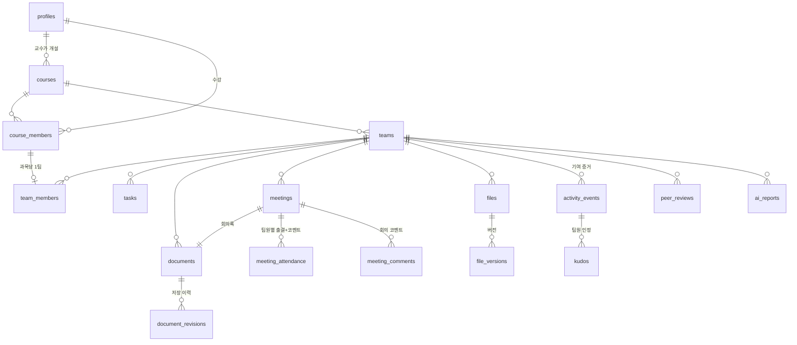

# DB 설계 (Supabase / Postgres)

마이그레이션: `supabase/migrations/`
1. `..._schema.sql` — 테이블, enum, 인덱스
2. `..._functions.sql` — 권한 헬퍼, 트리거, RPC, 기여도 산정
3. `..._rls.sql` — RLS 정책, 컬럼 권한, Storage 버킷, Realtime
4. `..._google_enum.sql`, 5. `..._google_drive.sql` — 구글 문서 연동 ([GOOGLE.md](GOOGLE.md))
6. `..._hanyang_login.sql` — 한양대 구글 계정 전용 가입, 교수 허용 목록, 데모 계정 ([AUTH.md](AUTH.md))

검증: `supabase/tests/db.test.mjs` (PGlite, 55개 시나리오 — 권한·점수·출결·조작 방지)

## 적용 방법
- **Supabase 대시보드** → SQL Editor에 1 → 2 → 3 순서로 붙여넣고 실행
- 또는 Supabase CLI: `supabase link --project-ref <ref>` → `supabase db push`
- Auth 설정: [AUTH.md](AUTH.md) (구글 로그인만, `@hanyang.ac.kr` 강제)

## ERD



## 핵심 설계 원칙

| 원칙 | 구현 |
|---|---|
| **기여 증거는 위조 불가** | `activity_events`·`document_revisions`·`file_versions`는 클라이언트 쓰기 정책 없음. 트리거와 서버 전용 RPC만 기록 |
| **학생은 자기 팀만, 교수는 자기 과목 전체를 읽기 전용** | `can_view_team()` / `is_team_member()` 기반 RLS. 교수는 쓰기 정책이 없음 |
| **글자 수는 서버가 계산** | 문서 diff·파일 텍스트 추출은 Next.js 서버 → `save_document` / `register_file_version` (service_role만 실행 가능) |
| **조작 방지** | 컬럼 단위 UPDATE 권한, 자기 확인/자기 kudos 금지, 변경 없는 재업로드 0점, 건당 점수 상한, 카테고리 점수 로그(수확체감) |
| **상호평가는 비공개** | 평가자 본인 + 담당 교수만 열람. 피평가자는 받은 평가를 못 봄 |

## 테이블 요약

| 테이블 | 설명 | 쓰기 주체 |
|---|---|---|
| `profiles` | 사용자 (role: student/professor). 가입 시 트리거로 생성 — `@hanyang.ac.kr` 구글 계정 또는 데모 계정만 | 본인(이름·학번·학과만) |
| `professor_emails` | 교수 이메일 허용 목록 (추가 시 기존 학생 계정 승격) | SQL Editor · service_role |
| `demo_accounts` | 심사용 데모 계정 허용 목록 (비밀번호 로그인 예외) | `seed:demo` 스크립트 |
| `courses` | 과목 + 초대코드 + 카테고리 가중치(합 100) | 교수 |
| `course_members` | 수강생 | `join_course(code)` RPC |
| `teams`, `team_members` | 팀 / 팀원 (과목당 1팀, 수강생만) | `create_team`, `join_team` RPC |
| `tasks` | 칸반. 완료자·확인자는 트리거가 관리 | 팀원 |
| `documents` | Tiptap 문서(kind: doc / meeting_note). `version`으로 낙관적 잠금 | 생성·제목만 팀원, 내용은 RPC |
| `document_revisions` | 저장 이력. 같은 작성자 1분 내 저장은 병합 | `save_document` |
| `meetings` | 회의(제목·일시·장소). 생성 시 회의록 문서 + 팀원 전원 출결 행 자동 생성 | 팀원 |
| `meeting_attendance` | 회의별 팀원 출결(`unchecked/present/late/absent/excused`) + 한 줄 코멘트(최대 300자). 체크자·코멘트 작성자 자동 기록 | 팀원 (**본인 출결 상태는 다른 팀원만** 체크, 본인은 사유 코멘트만) |
| `meeting_comments` | 회의 전체에 대한 코멘트 스레드(최대 500자) | 팀원 (수정·삭제는 작성자만) |
| `files`, `file_versions` | 같은 이름 재업로드 = 새 버전. 추출 텍스트·변경 요약 저장 | `register_file_version` |
| `activity_events` | **모든 기여의 단일 원천** (category, type, amount, points, ref) | 트리거 / RPC |
| `kudos` | 팀원 활동 인정 👍 (해당 활동 점수 ×1.2) | 다른 팀원 |
| `peer_reviews` | 기존 방식 상호평가 1~5점 | 팀원 |
| `ai_reports` | Claude 기여 요약 캐시 | 서버 |
| `google_accounts` | 팀원 ↔ 구글 계정(permissionId) + 암호화된 refresh token (토큰 컬럼은 클라이언트 조회 불가) | 서버(OAuth 콜백) |
| `external_docs` | 팀에 연결된 구글 문서·슬라이드·시트 | `link_external_doc` |
| `external_doc_revisions` | 구글 revision별 수정자 · 글자 변화. 미연결 팀원 수정은 보관 후 연결 시 소급 | `record_external_revision` |

## 점수 규칙 (`compute_points`)

| 활동 | 점수 |
|---|---|
| 구글 문서 수정 (`external_doc_edit`) | 문서는 문서, 슬라이드·시트는 파일 카테고리. 유효 글자(추가 + 삭제×0.5) 100자당 1점 (건당 최대 30점) |
| 문서/회의록 편집 | 유효 글자 100자당 1점 (건당 최대 30점). 유효 글자 = 직접 입력 + 붙여넣기×0.3 + 삭제×0.5 |
| 태스크 생성 | 0.5 |
| 태스크 완료 | 1.5 → **다른 팀원 확인 시 3** |
| 회의 출석 / 지각 | 1 / 0.5 (결석·사유 불참·미체크는 0) |
| 파일 버전 | (첫 업로드 또는 실제 변경 시) 2 + 변경 글자/200 (최대 25) + 변경·추가 슬라이드×0.5 (최대 20장) |

## 기여도 (`get_team_contributions(team_id)`)

```
카테고리 점수 = ln(1 + Σ 활동점수 × (kudos 있으면 1.2))      ← 수확체감: 몰아치기·스팸 억제
기여 비율     = Σ_카테고리 가중치 × (팀 내 카테고리 비율) / (활동이 있는 카테고리 가중치 합)
불일치 플래그 = |기여 비율 − 상호평가 비율| ≥ 15%p
```

반환: `user_id, name, document_score, task_score, meeting_score, file_score, raw_points, share_pct, peer_avg, peer_share_pct, mismatch, event_count, kudos_received`

테스트 시나리오 결과 예 (4인 팀, 모두가 서로 5점을 준 상호평가):

| 팀원 | 기여 비율 | 상호평가 비율 | 불일치 |
|---|---|---|---|
| 신환 | 39.1% | 25% | |
| 민성 | 36.1% | 25% | |
| 왕유 | 24.8% | 25% | |
| 무임승차 | 0.0% | 25% | ⚠️ |

## 회의 · 출결

```
회의 생성 ─┬─ 회의록 문서(kind=meeting_note) 자동 생성 → 편집 시 meeting 카테고리 점수
           └─ 팀원 전원 meeting_attendance 행 'unchecked' 생성
출결 체크  ─ 다른 팀원이 status 변경 → checked_by/checked_at 기록 → 출석·지각이면 activity_event
코멘트     ─ 팀원별 한 줄(예: "자료조사 발표", "연락 두절") / 회의 전체 스레드
```

출석률(`get_team_attendance`) = (출석 + 지각×0.5) / (출석 + 지각 + 결석) — 사유 불참·미체크 제외

| 팀원 | 회의 | 출석 | 지각 | 결석 | 출석률 |
|---|---|---|---|---|---|
| 민성 | 2 | 2 | 0 | 0 | 100% |
| 왕유 | 2 | 1 | 1 | 0 | 75% |
| 무임승차 | 2 | 0 | 0 | 2 | 0% |

## RPC 사용법

### 클라이언트 (supabase-js, 로그인 사용자)
```ts
await supabase.rpc('join_course', { p_invite_code: 'A1B2C3' })
await supabase.rpc('create_team', { p_course_id, p_name: 'A팀' })
await supabase.rpc('join_team', { p_team_id })
await supabase.rpc('get_team_contributions', { p_team_id })
await supabase.rpc('get_team_attendance', { p_team_id })  // 팀원별 출석·지각·결석·출석률
```

### 서버 전용 (Route Handler, service_role 키)
```ts
// 문서 저장: 서버가 세션으로 작성자 확인 + diff-match-patch로 글자 수 계산 후 호출
await admin.rpc('save_document', {
  p_document_id, p_author_id: user.id, p_base_version,
  p_content, p_content_text, p_chars_added, p_chars_removed, p_pasted_chars,
})
// 에러 'version_conflict'(40001) → 클라이언트에 새로고침 안내

// 파일 버전: 클라이언트가 team-files/{team_id}/{file_name}/{uuid} 로 직접 업로드 →
// 서버가 다운로드·텍스트 추출·이전 버전과 비교 후 호출
await admin.rpc('register_file_version', {
  p_team_id, p_uploader_id: user.id, p_file_name: '발표자료.pptx', p_storage_path,
  p_mime_type, p_size_bytes, p_extracted_text, p_chars_added, p_chars_removed,
  p_change_summary: { slides_changed: [3, 5], slides_added: [9] },
})
```

## Realtime 구독 대상
`tasks`, `documents`, `activity_events`, `meeting_attendance`, `meeting_comments`, `kudos` (RLS 적용됨)
문서 편집 잠금("B님이 편집 중")은 테이블 없이 Realtime Presence로 처리.

## 알려진 한계 (MVP)
- 상호평가 비율은 평가를 받은 팀원끼리만 정규화
